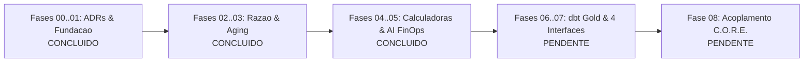

<div align="center">
  <h2>Jornada de Implementação — FinOps, CAPEX/OPEX & Revenue Lakehouse</h2>
  <p><i>Painel Vivo de Evolução Arquitetural, Contratos ODCS v3.1 & Entregas por Fase</i></p>
  <p><b>Versão:</b> 1.0.0 &nbsp;|&nbsp; <b>Última Atualização:</b> 2026-11-22 &nbsp;|&nbsp; <b>Padrões:</b> ADR-001 • ADR-002 • ADR-003 • DECIMAL(18,4)</p>
  <hr/>
</div>
<br/>

# Jornada de Implementação & Painel Vivo de Governança

Este artefato constitui a **Fonte Única da Verdade Operacional (SSOT)** do progresso de implementação do `finops-capex-revenue-lakehouse`, cruzando `state/project_progress.json` com `catalog/domains_registry.yaml`.

---

## 1. Painel de Status Executivo

- **Macrofase Ativa:** `Fase 05 - Conector AI/Cloud FinOps (POP_T_158)`
- **Status Geral de Governança:** `ON_TRACK`
- **Próxima Fase Planejada:** `Fase 06 - dbt-duckdb Gold Star Schema (100% Documentado)`
- **Progresso Estrutural das Fases:** **6 de 9 Concluídas (66.7%)**
- **Domínios Catalogados:** **6 domínios financeiros e analíticos**



---

## 2. Acompanhamento das Fases Estruturais (Fases 00 a 08)

| ID | Fase de Implementação | Status | Conclusão | Entregáveis Principais & Evidências |
| :---: | :--- | :---: | :---: | :--- |
| **Fase 00** | **ADRs Fundacionais & Bootstrap do Repositorio** | `CONCLUIDO` | `2026-11-22` | - ADR-001: Precisao decimal DECIMAL(18,4) sem float e storage hibrido Medallion<br/>- ADR-002: Chaves canonicas STRING, contratos ODCS v3.1 e quarentena<br/>- ADR-003: Isolamento LGPD/B2B (POP_T_154), Client Path Shield e defesa CWE-1236<br/>- PR #1 mergeado na main com AI SATELLITE SHIELD e licenca MIT |
| **Fase 01** | **Fundacao do Repositorio, .venv, CI/CD & Paineis Deterministicos** | `CONCLUIDO` | `2026-11-22` | - .venv Python 3.12 com requirements.txt e requirements-dev.txt 100% pinados com ==<br/>- pyproject.toml com entrypoints fcl e fcl-mcp + esqueleto src/finops_lakehouse<br/>- Workflows GitHub Actions (.github/workflows/ci.yml e pr-lint.yml)<br/>- Catalogo declarativo (domains_registry.yaml), project_progress.json, render_*.py e lint_dbt_docs.py |
| **Fase 02** | **Gerador Sintetico Deterministico & Ingestor CSV/XLSX** | `CONCLUIDO` | `2026-11-22` | - 24 meses de razao CAPEX/OPEX (50.016 lancamentos, seed=42) em partida dobrada e DECIMAL(18,4)<br/>- Motor hibrido SQLite WAL + DuckDB Parquet ZSTD, contrato ODCS v3.1 e quarentena<br/>- Ingestor/exportador CSV/XLSX com defesa CWE-1236, magic bytes, Zip-Bomb guard e Client Path Shield |
| **Fase 03** | **Aging de Recebiveis & Score de Cobranca** | `CONCLUIDO` | `2026-11-22` | - stg_faturas_recebiveis -> fct_receivables_aging (a_vencer, 0-30, 31-60, 61-90, 91-180, >180)<br/>- Matriz Markoviana de roll-rate, perda esperada (ECL = EAD * PD * LGD) e score de cobranca<br/>- Contrato ODCS v3.1 e testes de propriedade garantindo soma exata das faixas em Decimal |
| **Fase 04** | **Calculadoras B2B & Paridade CLT/PJ/USD-EUR** | `CONCLUIDO` | `2026-11-22` | - Economia B2B deterministica: NPV, IRR, Payback, margem bruta >= 65% e custo da inacao<br/>- Paridade CLT x PJ (Simples III/V + Fator R + ISS Manaus) x USD/EUR + Monte Carlo 10k (int64, seed=42)<br/>- Ponte macroeconomica ../public-data-gateway (PTAX/Selic/IPCA) com snapshot offline para CI |
| **Fase 05** | **Conector AI/Cloud FinOps (POP_T_158)** | `CONCLUIDO` | `2026-11-22` | - Catalogo de precos POP_T_158 v1.4.0 (44 modelos, tiers T1-T4, billing cliffs >100K/>200K/>272K) em Decimal puro<br/>- Gerador sintetico deterministico (seed=42) e leitor JSONL compativel com .logs/agent_telemetry.jsonl + redacao de segredos/CPF<br/>- Simulador de economia (Prompt Cache, Batch API -50%, DeepSeek Off-Peak UTC -50%) e materializacao Silver ZSTD com ODCS v3.1 |
| **Fase 06** | **dbt-duckdb Gold Star Schema (100% Documentado)** | `PENDENTE` | `-` | - 5 dimensoes (calendario, centro de custo, conta contabil, cliente/segmento, llm_model)<br/>- 4 fatos (capex_opex_variance, receivables_aging, b2b_deal_economics, ai_finops_consumption) |
| **Fase 07** | **Paridade nas 4 Interfaces & Vitrine Analitica BI** | `PENDENTE` | `-` | - Paridade matematica exata entre CLI fcl, SDK FinOpsLakehouse, FastAPI /api/v1/* e MCP fcl-mcp<br/>- App Streamlit + pacote Power BI (modelo Star Schema, medidas DAX e screenshots) |
| **Fase 08** | **Integracao e Acoplamento no Ecossistema C.O.R.E.** | `PENDENTE` | `-` | - POP oficial no core (get_next_pop_number.py + tech-sop-architect + tech-docs-formatter)<br/>- Skill inativa biz-finops-revenue-lakehouse + eval_cases.json + roteamento nos Orchestrators |

---

## 3. Gates Transversais de Qualidade & Segurança

| Gate | Nome do Gate | Critério de Aceite | Status |
| :---: | :--- | :--- | :---: |
| **GATE_01** | **Precisao Monetaria Estrita (DECIMAL 18,4)** | Zero IEEE 754 float em calculos e saidas financeiras; arredondamento ROUND_HALF_EVEN. | `PASSED` |
| **GATE_02** | **Chaves Canonicas STRING & Contratos ODCS v3.1** | Identificadores preservados em STRING, sentinelas normalizadas e desvios enviados para quarantine/. | `PASSED` |
| **GATE_03** | **Isolamento LGPD/B2B, Client Path Shield & CWE-1236** | Apenas dados sinteticos (seed=42) no repo publico; bloqueio de escrita real em data/; sanitizacao de planilhas. | `PASSED` |
| **GATE_04** | **CI/CD Verde & Sincronizacao Deterministica** | ruff check ., render_catalog.py --check, render_progress.py --check e pytest -m 'not live' verdes. | `PASSED` |
| **GATE_05** | **Cobertura dbt 100% Documentada** | dbt build e lint_dbt_docs.py com 100% dos modelos, fontes e colunas documentados. | `PENDING` |
| **GATE_06** | **Paridade Total 4 Interfaces & Acoplamento C.O.R.E.** | Mesmos valores Decimal em CLI, SDK, FastAPI e MCP + POP/Skill integrados ao core. | `PENDING` |

---

## 4. Trilha Histórica de Marcos Concluídos

| Data | Fase | Marco Realizado | Resumo Executivo |
| :---: | :---: | :--- | :--- |
| `2026-11-22` | **Fase 00** | **Bootstrap do Repositorio & ADRs Fundacionais (PR #1)** | Criacao do repositorio publico finops-capex-revenue-lakehouse com licenca MIT, .gitignore com AI SATELLITE SHIELD e aprovacao das ADRs 001, 002 e 003. |
| `2026-11-22` | **Fase 01** | **Fundacao Tecnica, CI/CD & Paineis Deterministicos (PR #2)** | Provisionamento do .venv Python 3.12 com dependencias pinadas (==), esqueleto finops_lakehouse (fcl/fcl-mcp), workflows ci.yml e pr-lint.yml, catalogo de 6 dominios e geradores deterministicos CATALOG.md e JORNADA_IMPLEMENTACAO.md. |
| `2026-11-22` | **Fase 02** | **Motor Medallion, Gerador Sintetico 50k & Ingestor CSV/XLSX CWE-1236 (PR #3)** | Implementacao do nucleo decimal sem float (DECIMAL(18,4)), storage SQLite WAL + DuckDB Parquet ZSTD, contrato ODCS v3.1 com partida dobrada e quarentena, gerador sintetico deterministico de 24 meses (50.016 lancamentos, seed=42), ingestor/exportador CSV/XLSX CWE-1236 e Client Path Shield. |
| `2026-11-22` | **Fase 03** | **Motor de Aging de Recebiveis, Roll-Rate, ECL & Score de Cobranca (PR #4)** | Implementacao de stg_faturas_recebiveis -> fct_receivables_aging nas 6 faixas canonicas, gerador sintetico sem PII com CNPJs 99xxxxxx Mod-11, matriz Markoviana de roll-rate, calculo deterministico de ECL e ranking de cobranca validados por testes de propriedade em Decimal. |
| `2026-11-22` | **Fase 04** | **Calculadoras Deterministicas B2B, Paridade CLT/PJ/FX & Monte Carlo 10k (PR #5)** | Implementacao de calculators/b2b_economics.py (NPV, IRR, Payback, gate de margem >= 65%, custo da inacao), calculators/career_parity.py (CLT vs PJ Anexo III/V + Fator R + ISS Manaus vs USD/EUR + Monte Carlo 10k int64 seed=42) e gateway_bridge (PTAX/Selic/IPCA com fallback offline). |
| `2026-11-22` | **Fase 05** | **Conector AI/Cloud FinOps, Catalogo POP_T_158 & Simulador de Economia (PR #6)** | Implementacao de finops_ai/pricing_catalog.py (44 modelos POP_T_158 v1.4.0, tiers T1-T4, billing cliffs em Decimal puro) e finops_ai/telemetry_connector.py (gerador seed=42, ingestor JSONL C.O.R.E. com quarentena e redacao de segredos, waterfall cache/batch/off-peak e Silver Parquet ZSTD sob contrato ODCS v3.1). |

---

## 5. Runbook Operacional (Setup & Verificação Local)

```powershell
py -3.12 -m venv .venv
.\.venv\Scripts\Activate.ps1
pip install -r requirements.txt -r requirements-dev.txt
pip install --no-deps -e .
ruff check .
python scripts/render_catalog.py --check
python scripts/render_progress.py --check
pytest -m "not live"
```
