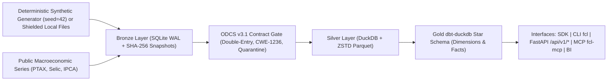
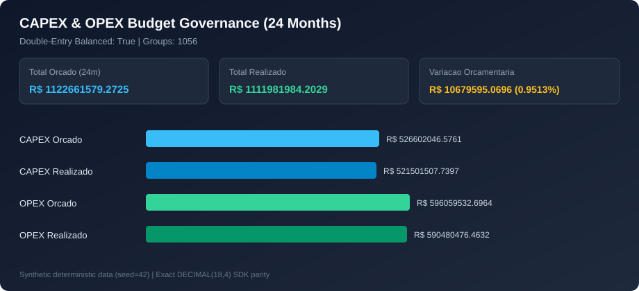
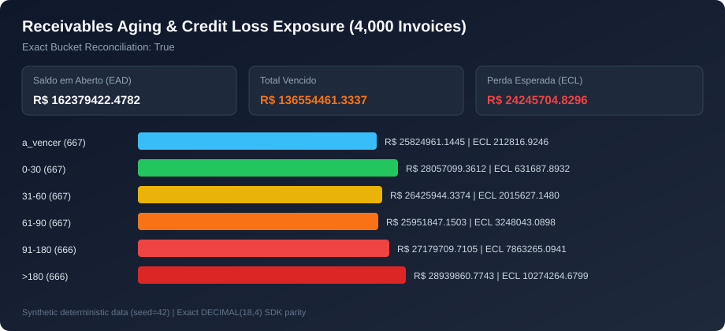
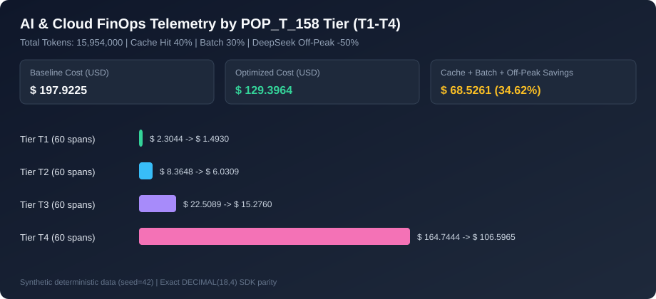

# FinOps, CAPEX/OPEX & Revenue Recovery Medallion Lakehouse

> Enterprise Financial Planning (CAPEX/OPEX), Delinquent Revenue Recovery (Aging & Collection Scoring), B2B Deal Economics & Cloud/AI FinOps Medallion Lakehouse (Python, DuckDB, dbt, Parquet, FastAPI, Power BI).

> **Synthetic Data & Privacy Notice (`ADR-003` / LGPD):**
> This public repository runs **100% on deterministic synthetic data (`seed=42`)** and public macroeconomic reference series (`PTAX`, `Selic`, `IPCA`). It contains **zero PII**, **zero real company/client identifiers**, and **zero proprietary corporate data**. External private datasets are isolated outside the repository via the **Client Path Shield**.

---

## 1. Architecture & Data Flow



### Core Architectural Guarantees
1. **Strict Monetary Precision ([`ADR-001`](docs/adr/ADR-001-decimal-precision-no-float.md)):**
   - All monetary quantities use `decimal.Decimal` (`ROUND_HALF_EVEN`) and `DECIMAL(18,4)` (`DECIMAL(12,6)` for rates/FX); `IEEE 754 float` is prohibited in financial ledgers, aging buckets, B2B economics, tax parity, and all 4 public interfaces.
   - 10,000-scenario Monte Carlo simulations execute in sub-second time using `int64` scaled arithmetic (`10^-4`) converted cleanly back to `Decimal`.
   - Gold SQL ratios (`variacao_pct`) execute via DuckDB `decimal_division(..., 6)` (`macros/decimal_divide.sql`) with zero intermediate `DOUBLE`.
2. **Canonical Keys, ODCS v3.1 & Double-Entry Contracts ([`ADR-002`](docs/adr/ADR-002-canonical-keys-odcs-contracts.md)):**
   - Explicit `STRING` relational keys (`id_lancamento`, `cod_centro_custo`, `cod_conta_contabil`, `id_contrato_masked`, `id_fatura_masked`, `cnpj_14`, `id_municipio`, `sigla_uf`).
   - Declarative `contract.yaml` policies enforce double-entry zero balance, aging summation identity, sentinel-to-`NULL` normalization, and quarantine isolation.
3. **LGPD, Client Path Shield & DevSecOps ([`ADR-003`](docs/adr/ADR-003-lgpd-b2b-client-path-shield.md)):**
   - Runtime **Client Path Shield** blocks persisting private external payloads inside `<repo_root>/data/`.
   - CSV/XLSX formula-injection defense (`CWE-1236`), recursive secret/CPF redaction, strict JSON float rejection, LFI prevention on HTTP/MCP endpoints, and `<untrusted_data>` XML delimiters for `fcl-mcp` (`OWASP LLM01`).

---

## 2. Quick Start (`<= 60s` on Synthetic Data)

```bash
git clone https://github.com/jhsfhtls/finops-capex-revenue-lakehouse.git
cd finops-capex-revenue-lakehouse

python -m venv .venv
source .venv/bin/activate  # Windows PowerShell: .\.venv\Scripts\Activate.ps1
pip install -r requirements.txt -r requirements-dev.txt
pip install --no-deps -e .

# End-to-end bootstrap (Silver ZSTD Parquet -> dbt build -> 100% docs lint in <= 60s)
python scripts/bootstrap_lakehouse.py

# Verify code quality, governance sync, and deterministic offline tests
ruff check .
python scripts/render_catalog.py --check
python scripts/render_progress.py --check
pytest -m "not live" -v
```

---

## 3. Unified 4-Interface Parity (`SDK` = `CLI` = `FastAPI` = `MCP`)

Every domain calculation and Gold Star Schema query delegates to [`FinOpsLakehouse`](src/finops_lakehouse/sdk.py), guaranteeing identical `DECIMAL(18,4)` / `DECIMAL(12,6)` results across all 4 interfaces:

1. **Python SDK:**
   ```python
   from finops_lakehouse import FinOpsLakehouse

   lakehouse = FinOpsLakehouse()
   variance = lakehouse.budget_variance(tipo_despesa="CAPEX", limit=10)
   aging = lakehouse.aging_priority(prioridade="P1_CRITICA", limit=10)
   deal = lakehouse.b2b_roi(
       initial_investment="100000.00",
       monthly_cashflows=["25000.00"] * 12,
       contract_revenue="300000.00",
       direct_delivery_cost="90000.00",
   )
   ```
2. **CLI (`fcl`):**
   ```bash
   fcl status --json
   fcl budget-variance --tipo-despesa CAPEX --limit 10 --json
   fcl aging-priority --prioridade P1_CRITICA --limit 10 --json
   fcl b2b-roi --initial-investment 100000.00 --monthly-cashflows 25000,25000,25000,25000,25000,25000 --contract-revenue 150000.00 --direct-delivery-cost 45000.00 --json
   fcl career-parity --clt-gross 18000 --pj-gross 26000 --contractor-fx 6000 --fx-currency USD --json
   fcl ai-finops --json
   ```
3. **FastAPI REST (`/api/v1/*`):**
   ```bash
   uvicorn finops_lakehouse.api.app:app --host 127.0.0.1 --port 8000
   # GET  /api/v1/health | /api/v1/budget-variance | /api/v1/aging-priority | /api/v1/ai-finops
   # POST /api/v1/b2b-roi | /api/v1/career-parity | /api/v1/ai-finops
   ```
4. **MCP Stdio Server (`fcl-mcp` with `<untrusted_data>` isolation):**
   ```bash
   fcl-mcp --check
   fcl-mcp --serve   # Exposes budget_variance, aging_priority, b2b_roi, career_parity, ai_finops
   ```

---

## 4. Analytics & BI Showcase (Streamlit + Power BI)

- Interactive Streamlit dashboard: [`bi/streamlit_app.py`](bi/streamlit_app.py) (`pip install -r bi/requirements-bi.txt && streamlit run bi/streamlit_app.py`)
- Power BI Semantic Package: [`bi/powerbi/finops_lakehouse.pbids`](bi/powerbi/finops_lakehouse.pbids), [`dax_measures.dax`](bi/powerbi/dax_measures.dax), and [`STAR_SCHEMA_POWERBI.md`](bi/powerbi/STAR_SCHEMA_POWERBI.md)







---

## 5. Repository Map

| Path | Purpose |
| :--- | :--- |
| [`docs/adr/`](docs/adr/) | Architecture Decision Records (`ADR-001`–`ADR-003`) |
| [`catalog/`](catalog/) & [`CATALOG.md`](CATALOG.md) | Domain registry, ODCS v3.1 contracts, and deterministic catalog |
| [`state/project_progress.json`](state/project_progress.json) & [`JORNADA_IMPLEMENTACAO.md`](JORNADA_IMPLEMENTACAO.md) | Implementation progress tracker and milestone log |
| [`src/finops_lakehouse/`](src/finops_lakehouse/) | Core storage/contracts, generators, receivables ECL, B2B/career calculators, AI/Cloud FinOps pricing & telemetry, SDK, CLI `fcl`, FastAPI & MCP `fcl-mcp` |
| [`dbt/`](dbt/) | `dbt-duckdb` Gold Star Schema (staging views, conformed dimensions, fact tables, and automated data tests) |
| [`bi/`](bi/) | Streamlit app, Power BI `.pbids` + DAX + Star Schema docs, and deterministic SVG previews |
| [`scripts/`](scripts/) | `bootstrap_lakehouse.py`, `materialize_silver.py`, `render_bi_showcase.py`, `render_catalog.py`, `render_progress.py`, `lint_dbt_docs.py` |
| [`tests/`](tests/) | Deterministic offline `pytest` verification suite (`test_foundation`..`test_phase07`) |
| [`.github/workflows/`](.github/workflows/) | GitHub Actions CI (`ci.yml`) and PR governance linting (`pr-lint.yml`) |
