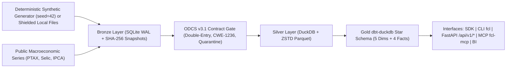

# FinOps, CAPEX/OPEX & Revenue Recovery Medallion Lakehouse

> Enterprise Financial Planning (CAPEX/OPEX), Delinquent Revenue Recovery (Aging & Collection Scoring), B2B Deal Economics & Cloud/AI FinOps Medallion Lakehouse (Python, DuckDB, dbt, Parquet, FastAPI, Power BI).

> **Synthetic Data & Privacy Notice (`ADR-003` / LGPD):**
> This public repository runs **100% on deterministic synthetic data (`seed=42`)** and public macroeconomic reference series (`PTAX`, `Selic`, `IPCA`). It contains **zero PII**, **zero real company/client identifiers**, and **zero proprietary corporate data**. External client, career, or study workloads are isolated outside the repository via the **Client Path Shield**.

---

## 1. Architecture & Data Flow



### Core Architectural Guarantees
1. **Strict Monetary Precision ([`ADR-001`](docs/adr/ADR-001-decimal-precision-no-float.md)):**
   - All monetary quantities use `decimal.Decimal` (`ROUND_HALF_EVEN`) and `DECIMAL(18,4)` (`DECIMAL(12,6)` for rates/FX); `IEEE 754 float` is prohibited in financial ledgers, aging buckets, B2B economics, and tax parity.
   - 10,000-scenario Monte Carlo simulations execute in sub-second time using `int64` scaled arithmetic (`10^-4`) converted cleanly back to `Decimal`.
2. **Canonical Keys, ODCS v3.1 & Double-Entry Contracts ([`ADR-002`](docs/adr/ADR-002-canonical-keys-odcs-contracts.md)):**
   - Explicit `STRING` relational keys (`id_lancamento`, `cod_centro_custo`, `cod_conta_contabil`, `id_contrato_masked`, `id_fatura_masked`, `cnpj_14`, `id_municipio`, `sigla_uf`).
   - Declarative `contract.yaml` policies enforce double-entry zero balance, aging summation identity, sentinel-to-`NULL` normalization, and quarantine isolation.
3. **LGPD, Client Path Shield & DevSecOps ([`ADR-003`](docs/adr/ADR-003-lgpd-b2b-client-path-shield.md)):**
   - Runtime **Client Path Shield** blocks persisting private external payloads inside `<repo_root>/data/`.
   - CSV/XLSX formula-injection defense (`CWE-1236`), secret isolation, and `<untrusted_data>` XML delimiters for `fcl-mcp` (`OWASP LLM01`).

---

## 2. Running Locally & Verification

### Prerequisites
- Python `3.12+` with strictly pinned (`==`) dependencies in [`requirements.txt`](requirements.txt) and [`requirements-dev.txt`](requirements-dev.txt).

```bash
python -m venv .venv
source .venv/bin/activate  # Windows PowerShell: .\.venv\Scripts\Activate.ps1
pip install -r requirements.txt -r requirements-dev.txt
pip install --no-deps -e .

# Lint, catalog/progress sync, CLI status & deterministic offline test suite
ruff check .
python scripts/render_catalog.py --check
python scripts/render_progress.py --check
fcl status --json
pytest -m "not live" -v
```

---

## 3. Repository Map

| Path | Purpose |
| :--- | :--- |
| [`docs/adr/`](docs/adr/) | Architecture Decision Records (`ADR-001`–`ADR-003`) |
| [`catalog/domains_registry.yaml`](catalog/domains_registry.yaml) & [`CATALOG.md`](CATALOG.md) | Declarative financial domain registry and deterministic catalog |
| [`state/project_progress.json`](state/project_progress.json) & [`JORNADA_IMPLEMENTACAO.md`](JORNADA_IMPLEMENTACAO.md) | Phase tracker SSOT and deterministic implementation dashboard |
| [`src/finops_lakehouse/`](src/finops_lakehouse/) | Core Python package, CLI (`fcl`), and MCP server (`fcl-mcp`) |
| [`scripts/`](scripts/) | Deterministic renderers (`render_catalog.py`, `render_progress.py`) and `lint_dbt_docs.py` |
| [`tests/`](tests/) | Deterministic offline `pytest` verification suite |
| [`.github/workflows/`](.github/workflows/) | GitHub Actions CI (`ci.yml`) and PR governance linting (`pr-lint.yml`) |

---

## 4. Suggested GitHub Repository Metadata

- **Description:** `Enterprise Financial Planning (CAPEX/OPEX), Delinquent Revenue Recovery (Aging & Collection Scoring), B2B Deal Economics & Cloud/AI FinOps Medallion Lakehouse (Python, DuckDB, dbt, Parquet, FastAPI, Power BI).`
- **Topics:** `finops`, `capex`, `opex`, `duckdb`, `dbt`, `medallion-architecture`, `parquet`, `fastapi`, `mcp`, `python`, `powerbi`
- **Profile Pin:** Recommended as flagship Financial Analytics & Lakehouse Engineering portfolio repository.
