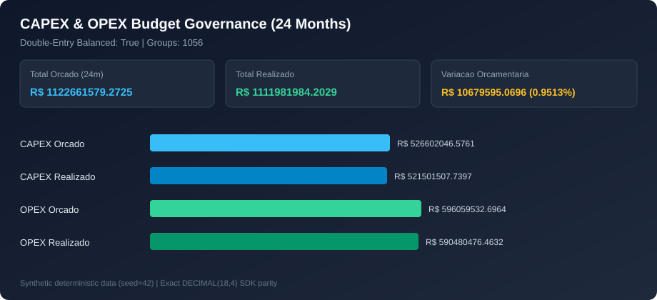
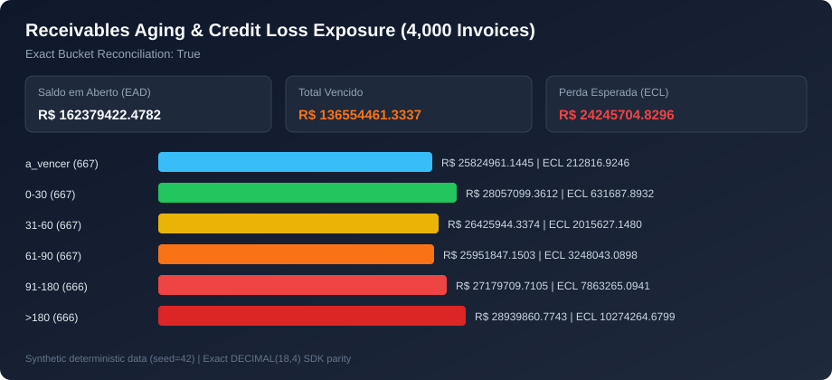
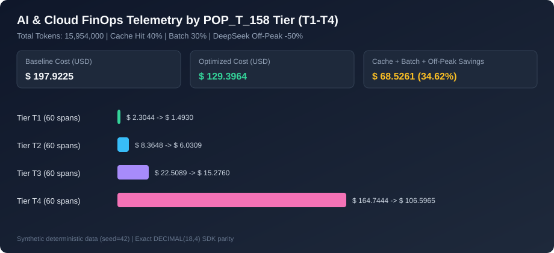

# Analytics & BI Showcase (`bi/`)

Deterministic visual showcase backed directly by [`FinOpsLakehouse`](../src/finops_lakehouse/sdk.py) and the `dbt-duckdb` Gold Star Schema (`data/gold/finops_lakehouse.duckdb`).

## 1. Automated Dashboard Previews (`seed=42`)







Regenerate these deterministic SVGs anytime:

```bash
python scripts/render_bi_showcase.py
```

## 2. Interactive Streamlit App

```bash
pip install -r bi/requirements-bi.txt
streamlit run bi/streamlit_app.py
```

## 3. Power BI Semantic Model Package

- Connection descriptor: [`powerbi/finops_lakehouse.pbids`](powerbi/finops_lakehouse.pbids)
- Enterprise DAX measures: [`powerbi/dax_measures.dax`](powerbi/dax_measures.dax)
- Star Schema relationship specification: [`powerbi/STAR_SCHEMA_POWERBI.md`](powerbi/STAR_SCHEMA_POWERBI.md)
