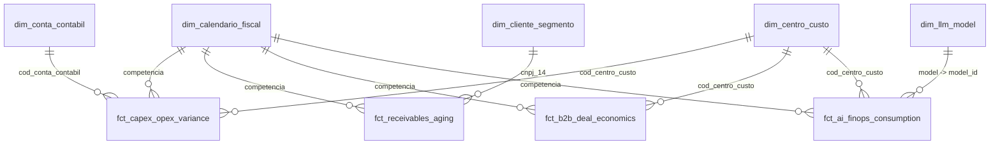

# Power BI Star Schema & Connection Guide

This directory packages the semantic Star Schema contract, Power BI Data Source descriptor ([`finops_lakehouse.pbids`](finops_lakehouse.pbids)), and enterprise DAX measures ([`dax_measures.dax`](dax_measures.dax)) backed by the dbt-duckdb Gold layer (`data/gold/finops_lakehouse.duckdb`).

## 1. Star Schema Relationships (`1:*` Single-Direction Filter Propagation)



| Dimension Table (`1`) | Fact Table (`*`) | Join Key | Filter Direction |
| :--- | :--- | :--- | :--- |
| `dim_calendario_fiscal` | `fct_capex_opex_variance`, `fct_receivables_aging`, `fct_b2b_deal_economics`, `fct_ai_finops_consumption` | `competencia` | Single (`Dim -> Fact`) |
| `dim_centro_custo` | `fct_capex_opex_variance`, `fct_b2b_deal_economics`, `fct_ai_finops_consumption` | `cod_centro_custo` | Single (`Dim -> Fact`) |
| `dim_conta_contabil` | `fct_capex_opex_variance` | `cod_conta_contabil` | Single (`Dim -> Fact`) |
| `dim_cliente_segmento` | `fct_receivables_aging` | `cnpj_14` | Single (`Dim -> Fact`) |
| `dim_llm_model` | `fct_ai_finops_consumption` | `model_id` = `model` | Single (`Dim -> Fact`) |

## 2. How to Refresh in Power BI Desktop

1. Run the deterministic end-to-end bootstrap (`<= 60s`):
   ```bash
   python scripts/bootstrap_lakehouse.py
   ```
2. Install the official DuckDB ODBC driver, open [`finops_lakehouse.pbids`](finops_lakehouse.pbids) in Power BI Desktop, and point `Database` to the local `data/gold/finops_lakehouse.duckdb` file in `READ_ONLY` mode.
3. Load the 5 dimensions and 4 fact tables under schema `main`, configure the `1:*` relationships listed above, and import the measures from [`dax_measures.dax`](dax_measures.dax).
